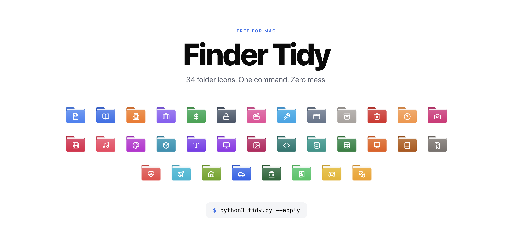
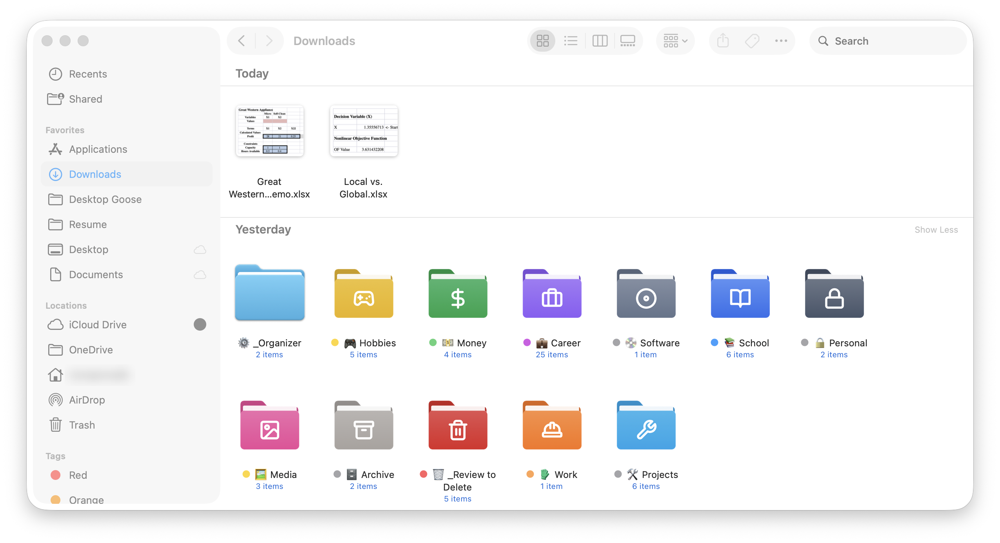

# Finder Tidy 🗂️

Turn a messy Mac Downloads folder into clean, colorful category folders you can tell apart at a glance.



Finder Tidy looks at every loose file, figures out what it is, and moves it into a folder like **📚 School**, **🧾 Receipts**, or **📷 Photos**. Each folder gets its own custom icon and a Finder color tag. It only creates the folders your files actually need, so a photographer and a student end up with different setups.

**It is safe by design**

* It previews first. Nothing moves until you say so.
* It never deletes anything. Junk goes to a **🗑️ Review to Delete** folder so you can decide.
* Every run is logged, and one command undoes it.
* It runs 100% offline. Nothing ever leaves your Mac.

**What it looks like in Finder:**



## Quick start

You need a Mac with Python 3. Type `python3 --version` in Terminal to check. If it's missing, macOS will offer to install it.

**Option A: no git needed.** Open Terminal and paste:

```bash
cd ~ && curl -L https://github.com/pomegranate692-creator/finder-tidy/archive/refs/heads/main.zip -o finder-tidy.zip && unzip -oq finder-tidy.zip && cd finder-tidy-main && python3 tidy.py
```

That downloads Finder Tidy and shows a preview of what it would do to your Downloads. Nothing moves yet. When you like the plan:

```bash
python3 tidy.py --apply
```

Prefer clicking? Hit the green **Code** button above, choose **Download ZIP**, unzip it, then drag `tidy.py` into Terminal after typing `python3 ` and press Return.

**Option B: with git.**

```bash
git clone https://github.com/pomegranate692-creator/finder-tidy.git
cd finder-tidy
python3 tidy.py            # preview
python3 tidy.py --apply    # do it
```

Changed your mind?

```bash
python3 tidy.py --undo
```

Works on any folder: `python3 tidy.py ~/Desktop --apply`

## What it does

| Step | What happens |
|---|---|
| **Sorts** | Uses file types, filename keywords, and a peek inside Word and text files to pick from 34 categories |
| **Auto detects** | Small groups fold into a parent (one song goes to Media instead of getting its own Music folder) |
| **Cleans** | Exact duplicates, Office lock files, empty files, broken downloads, and installers for apps you already have go to Review to Delete |
| **Archives** | Files you haven't touched in 180 days go to `Archive/<year>/` (resumes, taxes, and personal docs stay put) |
| **Styles** | Custom folder icons plus Finder color tags |
| **Respects your stuff** | Leaves your own folders alone and skips anything touched in the last 10 minutes |

## The 34 categories

**Core:** Documents, School, Work, Career, Money, Personal, Media, Projects, Software, Archive, Review to Delete, Sort Later
**Creative:** Photos, Videos, Music, Design, 3D Printing, Fonts, Screenshots, Wallpapers
**Tech:** Code, Data, Spreadsheets, Presentations, Ebooks, Compressed
**Life:** Health, Travel, Home, Car, Taxes, Receipts, Gaming, Fitness

Everything lives in [`categories.json`](categories.json): emoji, color, Finder tag, icon, file types, and keywords. Copy it, edit it, and run `python3 tidy.py --categories my-categories.json`.

## Options

| Flag | Does |
|---|---|
| `--apply` | Actually move files |
| `--undo` | Reverse the last run |
| `--min-files 3` | Smallest group that gets its own folder |
| `--archive-days 180` | Archive cutoff, `0` turns archiving off |
| `--no-emoji` | Plain folder names |
| `--no-icons` / `--no-tags` | Skip icons or color tags |
| `--style-only` | Just refresh icons and tags |
| `--plan-out plan.json` / `--plan-in plan.json` | Save a plan, edit it, then run it |

## Even smarter with Claude

The script sorts by rules. If you use [Claude](https://claude.ai), the included skill makes it sort by meaning: it reads PDFs and photos with useless names (`Document3.docx`, `IMG_4821.png`), renames them to things like `2026-09-03 Amazon Receipt Headphones.pdf`, and groups school work by course. Claude always shows you the plan before anything moves.

**Set it up in 3 steps:**

1. Download [`skill/SKILL.md`](skill/SKILL.md) (click it, then the download button).
2. In Claude, open **Settings**, find **Skills**, and upload the file. If you use Claude Code, put it at `~/.claude/skills/finder-tidy/SKILL.md` instead.
3. Say **"organize my downloads."** Claude grabs the script, reads your files, and shows you the plan before anything moves.

## Add your own icon

Icons are built from [`categories.json`](categories.json) with any [Lucide](https://lucide.dev) glyph:

```bash
# needs librsvg (brew install librsvg) and Pillow (pip3 install pillow)
python3 scripts/build_icons.py path/to/lucide/icons
```

## How the icons work

macOS stores a custom folder icon as a hidden `Icon` file inside the folder plus a flag on the folder. Color tags are a small extended attribute. Finder Tidy writes both directly, so it needs no extra apps and no Finder automation. Finder sometimes caches old icons. If one looks stale, run `python3 tidy.py --style-only`.

## Run the tests

```bash
python3 -m unittest discover tests
```

## Credits

Folder glyphs from [Lucide](https://lucide.dev) (ISC license, see `icons/glyphs/LICENSE`). Everything else is MIT.
